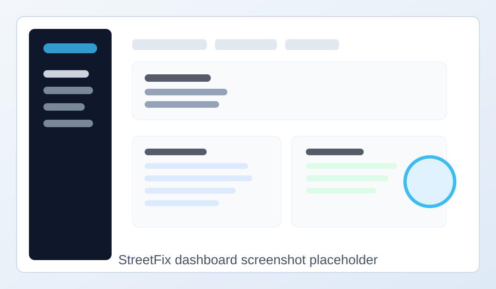
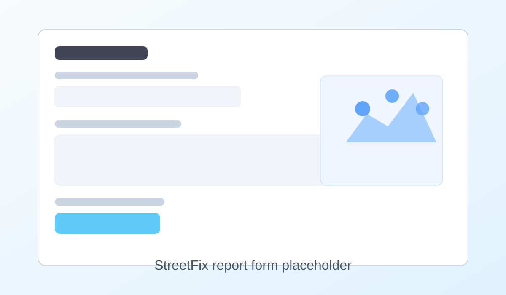
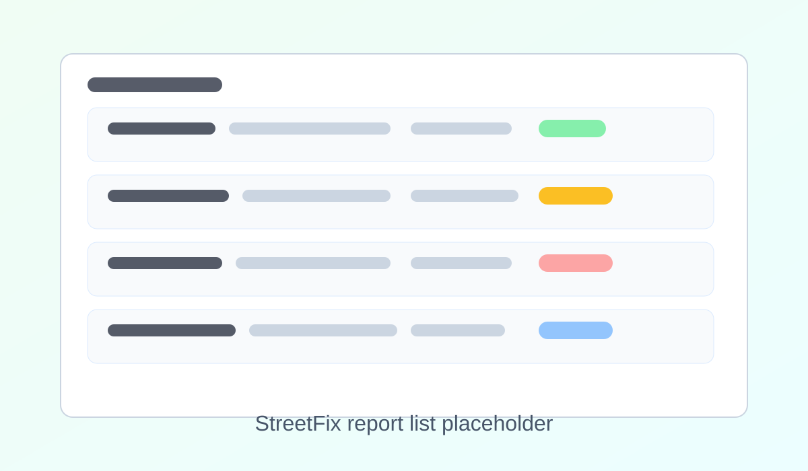

# StreetFix

StreetFix is a Rails web application built to help communities report and track local infrastructure issues such as potholes, broken sidewalks, damaged street lights, fallen trees, and downed power lines.

Residents can submit reports, add details about a problem, and vote to raise the visibility of issues that need attention. The app is designed to make it easier for communities to identify, prioritize, and monitor hazards in public spaces.

## Overview

StreetFix helps with:

- reporting location-based infrastructure problems
- describing the issue and adding context to a report
- increasing visibility through community voting
- reviewing and managing reports in an admin workflow
- creating a simple, user-friendly experience for public maintenance requests

## Runtime previews

The placeholders below are ready for real screenshots or app captures once the project is running locally.





## Tech stack

- Ruby 4.0.1
- Rails 8.1
- PostgreSQL
- Hotwire / Turbo / Stimulus
- Bootstrap styling
- Puma web server

## Prerequisites

The whole development environment (Ruby 4.0.1, Bundler, Rails, every gem and a
PostgreSQL server) is built from the `Dockerfile` in the repository root, so the
only things you need on your machine are:

- Git
- Docker (or Podman — replace `docker` with `podman` in the commands below)

## Installation

1. Clone the repository:

```bash
git clone <your-repository-url>
cd StreetFix
```

2. Build the image:

```bash
docker build -t streetfix .
```

3. Start the app. On first start the container creates, migrates and seeds the
   database; the named volume keeps your data between runs:

```bash
docker run --rm -p 3000:3000 -v streetfix-db:/var/lib/postgresql/data streetfix
```

Then open the application in your browser at:

```text
http://localhost:3000
```

### Using an external PostgreSQL server

By default the container runs its own PostgreSQL. To use another server
instead, pass its connection settings:

```bash
docker run --rm -p 3000:3000 \
  -e DB_HOST=db.example.com -e DB_USERNAME=streetfix -e DB_PASSWORD=secret \
  streetfix
```

### Running the tests

```bash
docker run --rm -e RAILS_ENV=test streetfix bin/rails test
```

## Common database commands

Run these inside the container, for example `docker run --rm -v streetfix-db:/var/lib/postgresql/data streetfix bin/rails db:reset`:

```bash
bin/rails db:setup
bin/rails db:reset
bin/rails db:migrate
```

## Default demo accounts

The application includes seeded users for testing:

- User: `user@example.com` / `password`
- Admin: `admin@example.com` / `password`

## Project maintenance

For project maintenance notes and operational guidance, see [docs/maintenance.md](docs/maintenance.md).

## License

This project is available under the terms in the repository license file.

## Milestones

- [x] report creation
- [x] user login and account creation
- [x] logout support
- [x] admin moderation actions
- [x] seeded testing data
- [x] homepage actions and navigation
- [x] vote counter support
- [x] sorting/filtering for reports

